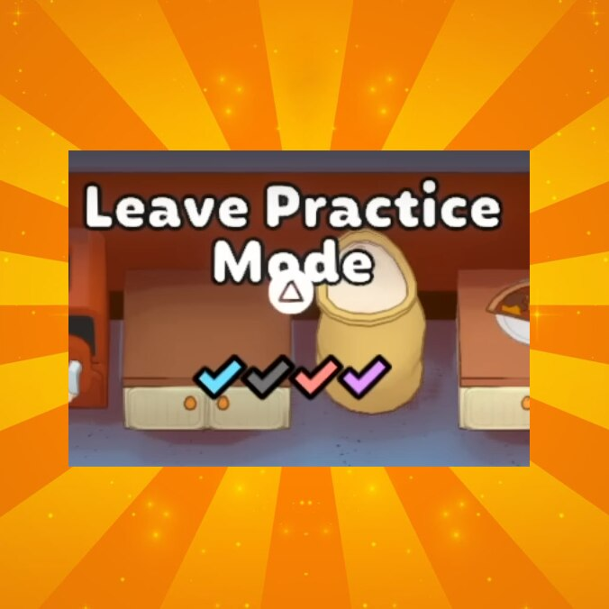

# PlateUp-ForceConsent

Mod for the PC Game 'PlateUp!'

View on the Steam Workshop: https://steamcommunity.com/sharedfiles/filedetails/?id=3238138908

## Force Consent

Are you always waiting for your friends to press accept when you just want to set one smart grabber or leave practice mode? The same guy is always afk or sleeping? Dont worry, just install "**Force Consent**", and wait no more!

## Features

- Auto accepts votes for Join/Leave Practice Mode when at least one person presses ready.
- Auto accept loading a savegame from the lobby if the host presses ready.
  Only the host needs this mod to work.

## Future Updates

Maybe adding the same logic as the savegame loading to other votes, but it might not always be intended and could be missclicked (e.g. abandoning a game). Let me know what you think!

## Build and test locally

Install [HarmonyX](https://steamcommunity.com/sharedfiles/filedetails/?id=2898033283) on the host.
Build the Release configuration with the .NET SDK and .NET Framework 4.7.2 targeting pack.
Set PlateUpSteamApps to the Steam library's steamapps folder. If the game and HarmonyX
are in different libraries, override PlateUpManagedPath and PlateUpHarmonyPath individually.

With the game closed, copy the Release DLL into PlateUp\Mods\ForceConsent next to
PlateUp_Data. Use a single copy of Force Consent on the host. On startup, check
Player.log for [ForceConsent] Installed vote patches.

In a two-player session with the mod on the host:

- Enter and leave practice with a single ready vote from either player.
- Confirm a guest voting alone in the load-save popup still waits. The host's vote should load the selected save.
- Confirm cancel and abandon-save votes still use PlateUp's normal rules.
